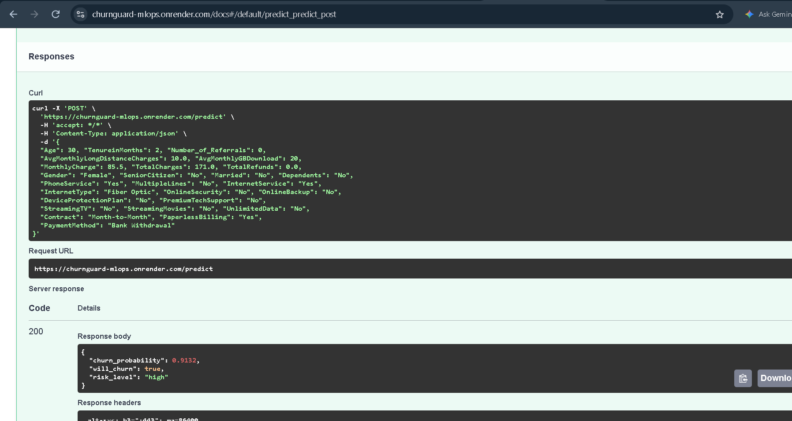
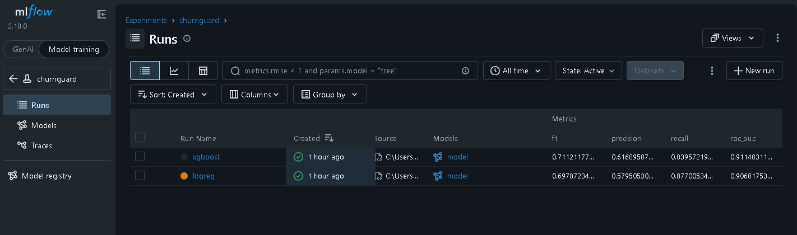
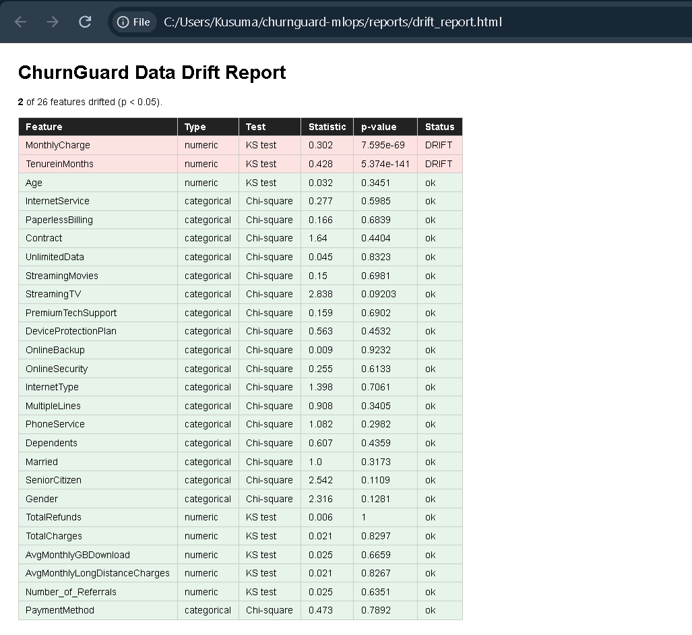

# ChurnGuard: Customer Churn Prediction (End-to-End MLOps)

Predict which telecom customers are about to leave, and act before they do.

**Live demo:** https://churnguard-mlops.onrender.com
*(Free hosting: the first request after idle time can take up to a minute.)*



## Problem
Keeping a customer costs far less than finding a new one. ChurnGuard scores each customer's probability of cancelling so a retention team can focus on the people most at risk.

## What it does
- **Single prediction:** enter a customer profile and get a churn probability, risk level and suggested actions.
- **Batch scoring:** upload a CSV of up to 500 customers and get a ranked risk table.
- **REST API:** `POST /predict` and `POST /predict-batch` (docs at `/docs`).


## Architecture
```
Raw data -> preprocessing -> train (MLflow tracking) -> saved model
         -> FastAPI -> Docker -> GitHub Actions CI -> Render
                    -> drift monitoring (KS and chi-square tests)
```

## Tech stack
Python, pandas, scikit-learn, XGBoost, MLflow, FastAPI, Pydantic, Docker, GitHub Actions, pytest, HTML/CSS/JavaScript, Render

## Results
Trained on 7,043 telecom customers with an 80/20 stratified split.

| Model | ROC-AUC | F1 | Precision | Recall |
|---|---|---|---|---|
| Logistic Regression | 0.907 | 0.698 | 0.580 | 0.877 |
| **XGBoost (deployed)** | **0.911** | **0.711** | **0.617** | **0.840** |

Accuracy is not used as the main metric because only about 26% of customers churn, so a model that always predicts "stays" would look 74% accurate and be useless.



Example predictions from the API:

| Customer | Churn probability | Risk |
|---|---|---|
| New, month-to-month, fiber, no support | 0.9132 | High |
| 60 months, two-year contract, support and security | 0.0044 | Low |

## Key engineering decisions
- **Removed data leakage:** the dataset contains `ChurnScore`, `CustomerStatus`, `ChurnCategory`, `ChurnReason`, `CLTV` and `SatisfactionScore`, which reveal or follow from the outcome. They are excluded, and a test enforces it.
- **Single sklearn Pipeline:** preprocessing and model are saved together, so training and serving cannot drift apart.
- **Experiment tracking:** every run's parameters, metrics and model are logged in MLflow.
- **Automated tests:** 7 pytest tests (API behavior, input validation, data cleaning, no leakage columns) run on every push through GitHub Actions, which also builds the Docker image.
- **Drift monitoring:** a Kolmogorov-Smirnov test (numeric features) and a chi-square test (categorical features) flag when new data differs from training data. I implemented this directly because Evidently did not support pandas 3.



## Run it locally
```bash
git clone https://github.com/KUSUMAMUNAGALA/churnguard-mlops.git
cd churnguard-mlops
python -m venv venv
venv\Scripts\activate          # Mac/Linux: source venv/bin/activate
pip install -r requirements.txt
python -m src.train            # trains and saves the model
uvicorn api.main:app --reload  # open http://localhost:8000
pytest -v                      # run the tests
python -m src.monitor          # create the drift report
```

### With Docker
```bash
docker build -t churnguard .
docker run -p 8000:8000 churnguard
```

## Project structure
```
api/       FastAPI app (predict, batch, web page)
src/       preprocess.py, train.py, monitor.py
web/       index.html (frontend)
tests/     pytest tests
data/      dataset and reference data
docs/      screenshots
```

## What I learned
- Why metrics like ROC-AUC and recall matter more than accuracy on imbalanced data
- How target leakage inflates scores and how to prevent it
- Packaging a model as an API with Docker and testing it in CI
- Diagnosing a dependency conflict and replacing a library with a statistical implementation

## Next steps
Automated retraining when drift is detected, a model registry, and SHAP explanations for each prediction.

## Author
kusuma · [GitHub](https://github.com/KUSUMAMUNAGALA)